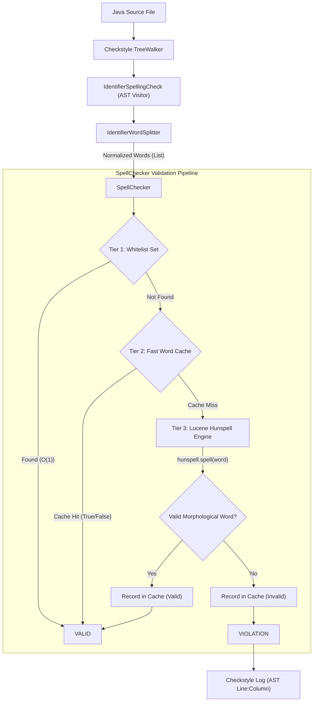
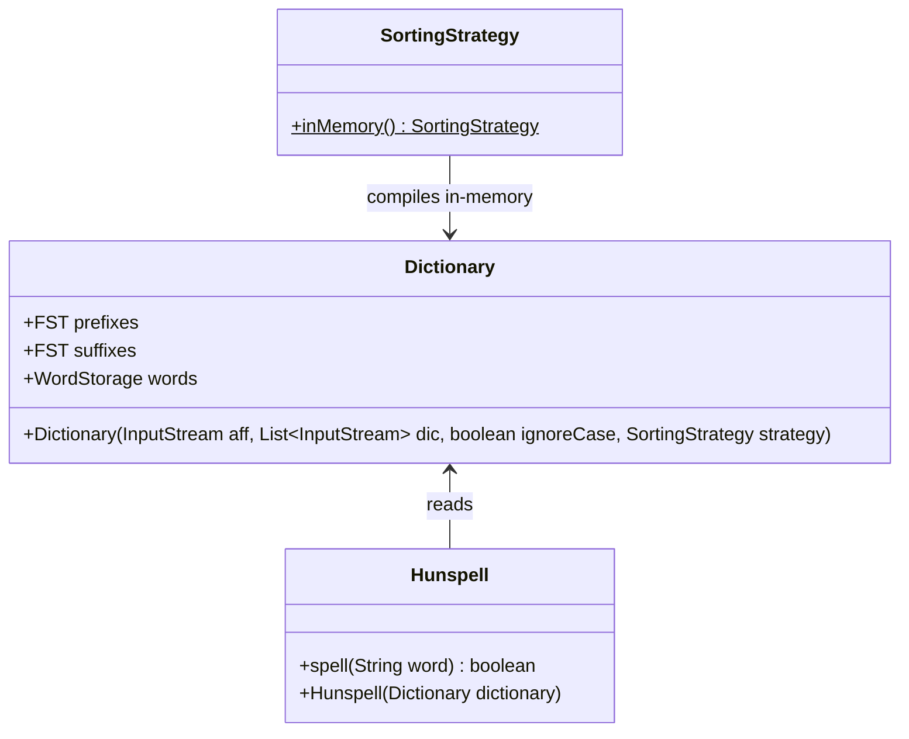
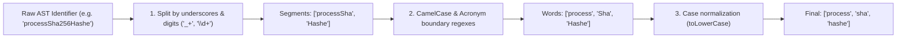
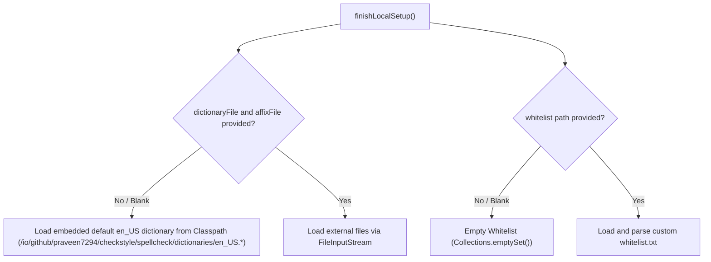

# Architecture Design: Checkstyle Spellcheck Extension

## 1. Overview & Objectives

The **Checkstyle Spellcheck Extension** (`checkstyle-spellcheck`) is an external Checkstyle module that inspects Java
Abstract Syntax Trees (ASTs) to validate the spelling of identifiers (classes, methods, variables, parameters, record
components, enum constants, annotations) against an embedded or custom Hunspell dictionary and an optional project
whitelist.

### Core Design Goals

1. **Lightweight Core Checkstyle**: Maintained as an independent extension JAR (
   `io.github.praveen7294:checkstyle-spellcheck`) discovered via Checkstyle SPI (`checkstyle_packages.xml`).
2. **Zero-Configuration Out-of-the-Box**: Ships with standard `en_US` Hunspell dictionary (`en_US.aff` and `en_US.dic`)
   embedded as classpath resources.
3. **High-Throughput AST Processing**: Analyzes hundreds of thousands of identifiers across large codebases in
   milliseconds with minimal CPU and memory overhead.
4. **Morphology-Aware Validation**: Leverages **Apache Lucene Hunspell** to understand English morphology (affixes,
   prefixes, suffixes, compound rules) rather than brittle, flat word lists.
5. **Resilient Lexical Splitting**: Accurately decomposes `camelCase`, `PascalCase`, `UPPER_SNAKE_CASE`, acronyms (
   `HTTPServer`, `JSONResponse`), and digits (`sha256Hash`, `param1`).

## 2. High-Level Architecture

The system divides responsibilities into four distinct layers:

## 3. Apache Lucene Hunspell Internals

### The Power of `.dic` and `.aff`

Unlike static word lists that require storing every form of a word (`write`, `writes`, `writing`, `written`), Hunspell
uses two coordinated files:

* **`.dic` (Dictionary File)**: Base stems associated with morphological flags (`write/SDR`).
* **`.aff` (Affix Rule File)**: Linguistic production rules (prefixes, suffixes, inflections, replacement tables).

### Engine Components in Lucene 10

1. **`org.apache.lucene.analysis.hunspell.Dictionary` (Heavyweight, Immutable)**:
    * Parses `.aff` rules and compiles prefixes/suffixes into **Finite State Transducers (FSTs)**.
    * Compiles `.dic` words using `SortingStrategy.inMemory()`.
    * Compiled **once** per check configuration in `finishLocalSetup()`. Strictly read-only and thread-safe.
2. **`org.apache.lucene.analysis.hunspell.Hunspell` (Lightweight Query Engine)**:
    * Built on top of `Dictionary`.
    * Ultra-fast $O(\text{word length})$ lookups via `spell(String)`.

## 4. Performance & Lifecycle Optimization

### 1. Checkstyle Lifecycle Integration (`finishLocalSetup`)

Checkstyle instantiates `IdentifierSpellingCheck` as a `@StatelessCheck`. In `finishLocalSetup()`, the `SpellChecker` is
compiled **once**:

* For zero-config runs: It streams `en_US.aff` and `en_US.dic` from embedded classpath resources.
* For custom dictionary runs: It streams external files from disk.
* Across all files audited in a single run, dictionary compilation happens exactly once.

### 2. Three-Tier Validation Pipeline

| Tier | Component | Time Complexity | Purpose |
| :--- | :--- | :--- | :--- |
| **Tier 1** | Project Whitelist (`Set<String>`) | $O(1)$ | Immediate bypass for project acronyms and jargon (`dto`, `dao`, `uuid`, `regex`). |
| **Tier 2** | Fast Word Cache (`ConcurrentHashMap<String, Boolean>`) | $O(1)$ | Caches both positive (`true`) and negative (`false`) lookups for common identifiers (`user`, `name`, `get`, `set`, `id`). |
| **Tier 3** | Lucene `Hunspell.spell()` | $O(\text{length})$ | Traverses affix trees and root tables for words not yet seen. The result is automatically recorded in Tier 2. |

## 5. Identifier Word Splitting Pipeline

Java identifiers combine multiple words using varying conventions. `IdentifierWordSplitter` normalizes identifiers
before validation:

### Splitting Specification

* **Underscores**: Separated by `Pattern.compile("_+")`.
* **Digits**: Separated by `Pattern.compile("\\d+")`.
* **Lower to Upper (Camel/Pascal)**: `Pattern.compile("(?<=[a-z])(?=[A-Z])")`.
* **Acronym Boundaries**: `Pattern.compile("(?<=[A-Z])(?=[A-Z][a-z])")` (`HTTPServer` → `http`, `server`).
* **Normalization**: All emitted words are normalized to lowercase (`Locale.ROOT`).

## 6. Resource Resolution

## 7. Component Specifications

### `IdentifierSpellingCheck.java`

* Extends `AbstractCheck`.
* Annotated with `@StatelessCheck`.
* Audits 11 AST tokens:
    - Types: `CLASS_DEF`, `INTERFACE_DEF`, `RECORD_DEF`, `ENUM_DEF`, `ANNOTATION_DEF`
    - Members: `METHOD_DEF`, `VARIABLE_DEF`, `PARAMETER_DEF`, `RECORD_COMPONENT_DEF`, `ANNOTATION_FIELD_DEF`,
      `ENUM_CONSTANT_DEF`
* Properties:
    - `dictionaryFile` (`String`)
    - `affixFile` (`String`)
    - `whitelist` (`String`)

### `SpellChecker.java`

* Thread-safe validation engine.
* Constructors:
    - `SpellChecker()` (Embedded default dictionary, no whitelist)
    - `SpellChecker(String whitelistPath)` (Embedded default dictionary + whitelist)
    - `SpellChecker(String dicPath, String affPath, String whitelistPath)` (Custom or embedded fallback)
* Method: `public boolean isCorrect(String word)`.

### `IdentifierWordSplitter.java`

* Pure-Java stateless utility class.
* Method: `public static List<String> split(String identifier)`.
