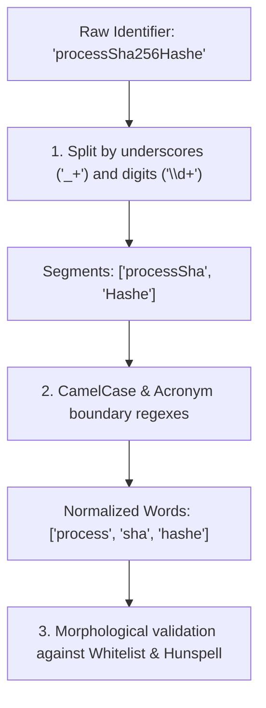

# Tokens & Identifier Splitting

Java identifiers rarely consist of single dictionary words. They combine multiple words, abbreviations, and digits
following diverse naming conventions.

---

## 1. Supported Declaration Tokens

`IdentifierSpellingCheck` audits all 11 Java declaration AST tokens:

| Category | Token | Example in Java Code | Audited Identifier |
| :--- | :--- | :--- | :--- |
| **Types** | `CLASS_DEF` | `public class UserAccount` | `UserAccount` |
| | `INTERFACE_DEF` | `public interface OrderRepository` | `OrderRepository` |
| | `RECORD_DEF` | `public record LineRecord(...)` | `LineRecord` |
| | `ENUM_DEF` | `public enum SeasonType` | `SeasonType` |
| | `ANNOTATION_DEF` | `public @interface ServiceAuditor` | `ServiceAuditor` |
| **Members** | `METHOD_DEF` | `public void printUserName()` | `printUserName` |
| | `VARIABLE_DEF` | `private String userAddress;` | `userAddress` |
| | `PARAMETER_DEF` | `void save(int maxRetryCount)` | `maxRetryCount` |
| | `RECORD_COMPONENT_DEF` | `record Order(String lineItem)` | `lineItem` |
| | `ANNOTATION_FIELD_DEF` | `String defaultName() default "";` | `defaultName` |
| | `ENUM_CONSTANT_DEF` | `MAX_BUFFER_SIZE` | `MAX_BUFFER_SIZE` |

---

## 2. Identifier Word Splitting Pipeline

`IdentifierWordSplitter` normalizes complex identifiers through a robust multi-stage pipeline:

### Supported Naming Styles

* **`camelCase`**: `userAddress` → `user`, `address`
* **`PascalCase`**: `UserAccount` → `user`, `account`
* **`UPPER_SNAKE_CASE`**: `MAX_BUFFER_SIZE` → `max`, `buffer`, `size`
* **Consecutive Uppercase / Acronyms**: `HTTPServer` → `http`, `server`; `parseJSONResponse` → `parse`, `json`,
  `response`
* **Embedded Digits**: `sha256Hash` → `sha`, `hash`; `param1` → `param`
